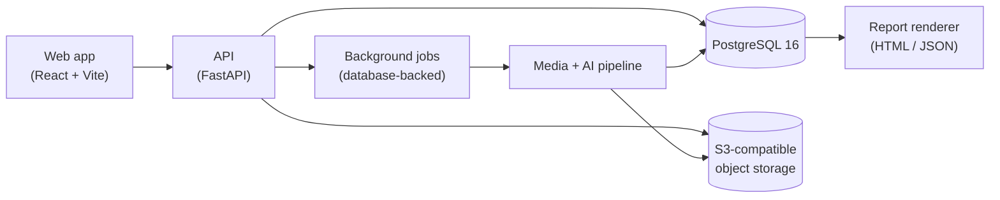

# UpClose

Video-based used-car condition screening: film a car, get a private, evidence-linked condition report.

UpClose helps buyers and sellers document a used car's visible condition before an in-person inspection. It is a screening tool — it does not replace an inspection by a qualified mechanic.

## What it does

1. **Capture.** Record guided clips for eight areas of the car — driver side, passenger side, front and rear body, tires, dashboard, engine bay, underbody, and interior — or upload one continuous video (up to 3 minutes and 200 MiB). In a single video you can optionally mark sections so findings keep their original timestamps, and any uncovered areas can be filmed afterwards as guided follow-ups.
2. **Upload.** Clips are uploaded directly to private object storage. Processing runs in the background and progress is shown in the browser.
3. **Assess.** The backend normalizes the media, identifies the vehicle first, and only then looks for damage on the vehicle-masked media. Candidate findings are verified and deduplicated before anything is shown.
4. **Score.** A deterministic scoring engine turns verified findings into a condition score that accounts for coverage: areas that were not filmed, were too blurry, or could not be assessed are reported as uncovered rather than treated as clean.
5. **Report.** You get a private report (HTML and JSON) where every displayed finding links back to its persisted evidence — the frame and location it came from. A free preview shows the headline result; the full evidence report is unlocked with a payment.

## Key features

- **Two ways to film:** step-by-step guided clips, or one continuous walk-around video with optional marked sections.
- **Two-stage AI pipeline:** vehicle segmentation runs first and produces a mask; damage segmentation runs second, only on masked media. This keeps scratches, dents, and rust candidates tied to the car itself rather than the background.
- **Verified, deduplicated findings:** model output is validated before it is stored or shown. Uncertain candidates are not silently turned into clean results, and model confidence is presented as uncalibrated — not as an accuracy probability.
- **Coverage-aware deterministic scoring:** the same inputs always produce the same score. Missing, failed, or unsupported coverage lowers completeness instead of inflating the result.
- **Evidence-linked reports:** every finding in the paid report points to its source evidence. Free previews cannot access paid evidence through the page, the API, image routes, or caches.
- **Private by default:** reports are owner-only and public sharing is disabled. Deleting an inspection immediately revokes access, and stored media is then purged and verified gone.
- **Optional accounts:** dealers and frequent sellers can create an email/password account to claim inspections and revisit earlier reports. The anonymous one-off flow works without an account.
- **Test-mode payments:** report unlock uses Stripe in test mode. Payment status is confirmed from verified provider state — simply returning to the site in the browser grants nothing.

## Architecture



| Component | What it does |
|---|---|
| `apps/web` | Browser app: consent, guided and single-video capture, upload, live progress, free preview, checkout return, and the private owner report. |
| `services/api` | FastAPI backend: sessions, uploads, accounts, billing, deletion, and report endpoints, plus the background processing pipeline (media normalization, vehicle masking, damage segmentation, verification, deduplication, scoring, and report generation). |
| `infra` | Docker Compose stack and container definitions for local running. |
| `scripts` | Local launch and verification entry points. |

Processing is idempotent where it matters: jobs may run more than once, but committed results and charges are tracked so a retry does not double-publish or double-charge.

## Quick start

Requirements: Docker Desktop (or Docker Engine with Compose) running locally.

```powershell
docker compose -f infra/compose.yaml up --build -d
docker compose -f infra/compose.yaml exec api alembic upgrade head
```

Then open:

| Service | Address |
|---|---|
| Web app | http://localhost:5173 |
| API liveness | http://localhost:8000/health |
| API readiness | http://localhost:8000/ready |
| PostgreSQL | localhost:55432 (internal port 5432) |
| Object storage (local emulator) | localhost:4566 |

All ports bind to loopback only. The default stack runs in fixture mode, so no `.env` file, API keys, or payment credentials are needed. Source is copied into the images, so rebuild after editing backend or frontend code:

```powershell
docker compose -f infra/compose.yaml up --build -d
```

Stop the stack with:

```powershell
docker compose -f infra/compose.yaml stop
```

Do not remove volumes unless you intend to discard local data.

## Configuration

Configuration is via environment variables; `.env.example` lists the full surface with local development placeholders only. The settings that matter most:

| Variable | Default | Meaning |
|---|---|---|
| `MODEL_MODE` | `fixture` | `fixture` runs the whole pipeline offline with synthetic data and no model calls. Live model mode is opt-in, runs only in the background processor, and is subject to per-session and daily budget caps. |
| `PAYMENTS_MODE` | `fixture` | `fixture` uses an in-process fake payment flow. `test` uses Stripe test mode and requires test keys; live Stripe keys are refused. |
| `PUBLIC_SHARING_ENABLED` | `false` | Public report sharing stays off. |
| `SESSION_CREATION_LIMIT_PER_DAY` | `3` | Per-owner daily limit on new inspections. |
| `OPERATOR_TOKEN` | empty | Separate credential for operator endpoints; empty disables them. |

## Running tests

The full local verification suite rebuilds the images, creates its own disposable test database (removed afterwards), and runs backend tests including real PostgreSQL concurrency and migration checks, plus web type checks, tests, and production builds:

```powershell
./scripts/verify-local.ps1
```

Backend only:

```powershell
./scripts/verify-local.ps1 -BackendOnly
```

Targeted checks inside the running containers:

```powershell
docker compose -f infra/compose.yaml exec api python -m pytest
docker compose -f infra/compose.yaml exec web npm run typecheck
docker compose -f infra/compose.yaml exec web npm run test -- --run
docker compose -f infra/compose.yaml exec web npm run build
```

Plain pytest skips PostgreSQL integration tests unless a disposable test database URL is supplied; the verification script above handles that automatically. Tests run in fixture mode and make no model calls.

## Project layout

```
apps/web/       Browser app (React, TypeScript, Vite)
services/api/   Backend API, background processing, and tests (Python, FastAPI)
infra/          Docker Compose files and container definitions
scripts/        Local launch and verification scripts
```

## Status

UpClose is a working prototype, and we want to be direct about what that means:

- **Fixture results are synthetic.** The default offline mode exercises the complete flow — capture, upload, pipeline, scoring, report, payment, and deletion — with synthetic data. It demonstrates the product, not detection quality.
- **Live AI quality is not yet validated.** The live pipeline path exists and is opt-in, but accuracy has not been measured against independently labeled real-world footage, so no detection-quality claims are made.
- **Not a production system.** Local storage emulation does not establish production storage behavior, and real-device capture and payment fulfillment in a hosted environment remain to be proven end to end.
- **Screening, not certification.** Even with validated models, a video screening cannot see everything an in-person mechanical inspection can.
